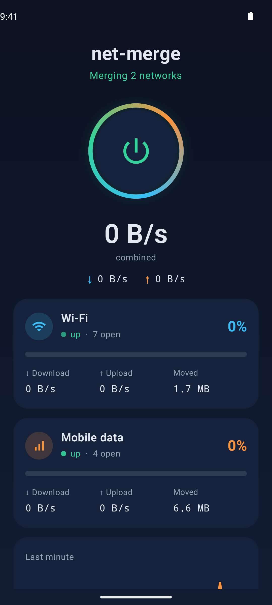
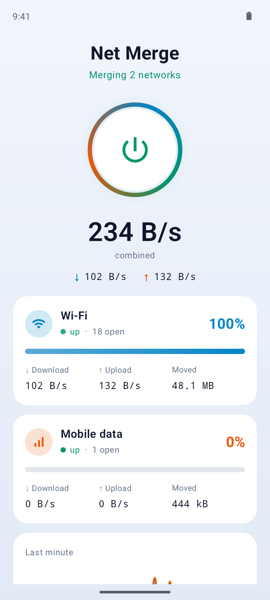
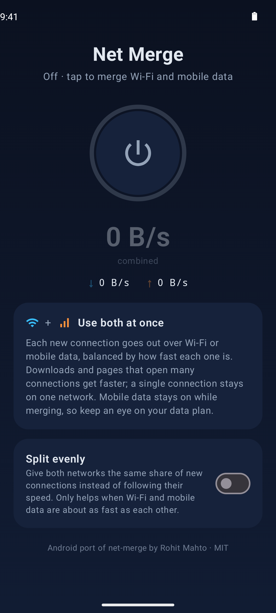

<h1 align="center">net-merge for Android</h1>

<p align="center">
  <b>Use Wi-Fi and mobile data at the same time.</b><br>
  No root, no account, no server in between.
</p>

<p align="center">
  The official Android app of <a href="https://net-merge.org">net-merge</a>.<br>
  <a href="https://github.com/net-merge/android/releases/latest/download/net-merge-android.apk"><b>Download the APK</b></a>
</p>

<p align="center">
  
  &nbsp;
  
  &nbsp;
  
</p>

## What it does

Your phone normally uses only one network at a time: Wi-Fi when it is connected, mobile data
otherwise. net-merge keeps both connected and spreads your apps' connections across them.
Faster networks get more connections, and a network that loses internet stops getting any.

## What it speeds up

net-merge helps with anything that opens **several connections at once**:

- **Web pages**, which load many images and files in parallel
- **Torrents**, which use dozens of connections
- **Cloud backups and sync**, like Google Photos or Google Drive uploading several files
- **Download manager apps** that split one file into parts (for example ADM or 1DM)
- **Ookla Speedtest in Multi mode**

It also keeps you online: if Wi-Fi drops, new connections go over mobile data.

### Ethernet

A wired connection through a USB-C / OTG Ethernet adapter or dock is merged too, next to Wi-Fi
and mobile data. Plug it in while merging is on and it shows up as its own **Ethernet** card;
unplug it and its connections move to the other networks. Two adapters show up as
"Ethernet" and "Ethernet 2". Your phone must support USB Ethernet (most Android 9+ phones do).

## Limitations

The app shows these too, so nobody has to find them here first.

- **One connection always stays on one network.** A Play Store download, a single browser download, one
  video stream, online games and video calls mostly use one connection. They don't get faster, and they use
  only one network at a time. They are never slower than that network on its own. We measured a 1 GB Play
  Store download on a real phone: all of it went over one connection, on TCP and on QUIC alike.
- **Splitting one connection over two networks needs a server in the middle.** net-merge has no server, and
  it can't read inside encrypted connections, so it can't ask for parts of a file the way ADM does.
- **Two networks only add up if each reaches the internet by its own path.** The total can't beat the two
  speeds added together: with 400 Mbit/s Wi-Fi and 60 Mbit/s mobile data, the best possible is about 460.
- **Android allows one VPN app at a time,** so net-merge can't run next to another VPN.
- **Mobile data stays on** while it runs and counts against your plan.
- **Some sites tie your login to one address.** net-merge may use a different address for each connection, so
  such a site can ask you to log in again.
- **Sites that only have IPv6** can't be reached while "Use all networks" is on and your networks differ in
  IPv6 support.

## Install

1. On your phone, tap **[Download the APK](https://github.com/net-merge/android/releases/latest/download/net-merge-android.apk)**.
   Every version is on the [Releases](https://github.com/net-merge/android/releases) page, with SHA-256 checksums.
2. Open the downloaded file and install it. If Android asks, allow your browser or file
   manager to install unknown apps.
3. Open **net-merge**, tap the power button and tap **OK** on the VPN prompt.
4. Optional: add the **net-merge** tile to your Quick Settings panel for one-tap on/off.

Requires Android 8.0 or newer.

## Using it

- **Power button:** turns merging on and off. A notification with a Stop button stays while it
  is on.
- **Network cards:** each network's status, its share of the traffic, and its live download and
  upload speeds.
- **Speed limit:** tap *Speed limit* on a network to cap it: 1, 2, 5, 10, 20, 50 or 100 Mbit/s, or any other
  speed. The cap covers that network's downloads and uploads, across all of its connections, and it is kept
  after a restart.
- **Last minute:** a live chart of how much each network carried.
- **Split evenly:** gives both networks the same share of new connections instead of following
  their speed. Only useful when Wi-Fi and mobile data are about as fast as each other.
- **Use all networks:** uses IPv6 only if every network has it, so apps use both networks.
- **Pause when there is only one connection:** pauses by itself when fewer than two networks have internet,
  and starts again when a second one works. Switching it by hand always wins.
- **Start when the phone starts:** starts net-merge after a restart.
- **Version line:** shows the version. When a newer one is out it turns into *Update to vX*, which opens the
  release page. The app checks at start and every 6 hours, and installing stays your choice.

Mobile data stays on the whole time merging is active, so keep an eye on your data plan.

## What to expect

- **A single connection always stays on one network.** One large file download, or a speed test
  set to "Single" connection, won't get faster. Use "Multi" in Ookla Speedtest to see the
  combined speed.
- **The gain depends on how close the two networks are in speed.** Two similar networks can come
  close to doubling. If Wi-Fi is 400 Mbps and mobile data is 60 Mbps, the best possible total is
  about 460 Mbps.
- **Upload works the same way.** It only adds up when an app uploads over several connections,
  and mobile data's upload is often much slower than its download.

## How it works

net-merge is a local VPN. Android sends all traffic to the app, and the app opens each
connection again over Wi-Fi or mobile data, then passes the data back and forth. Nothing goes
through an outside server: the VPN exists only on your phone.

For developers, in more detail:

- The VPN's interface is handled on the phone by a user-space TCP/IP stack
  ([gVisor](https://gvisor.dev) via [tun2socks](https://github.com/xjasonlyu/tun2socks)).
- Each outgoing socket is tied to one network with `android_setsocknetwork` (the NDK form of
  `Network.bindSocket`). The app leaves itself out of its own VPN, so those sockets go straight
  out.
- Android normally turns mobile data off while Wi-Fi is connected (and Wi-Fi off while Ethernet
  is). The app keeps Wi-Fi, cellular and Ethernet up with `ConnectivityManager.requestNetwork`,
  and follows networks coming and going with `NetworkCallback`.
- The balancing engine (scheduler, balancer, internet checks and speed limits) is the Go code from
  [net-merge](https://github.com/net-merge/net-merge) by Rohit Mahto, built for Android with
  gomobile. Android adds a few things on top: a new connection goes to the network where its app has the
  fewest connections moving data (Android can say which app owns a connection), QUIC sockets count like TCP
  connections, the first weights come from Android's speed estimate, weights stay within 2:1, and they
  follow upload speed while traffic is mostly upload.

## Building from source

You need Go 1.27 or newer, JDK 17, the Android SDK and an Android NDK.

```sh
export ANDROID_HOME=~/Android/Sdk
export ANDROID_NDK_HOME=$ANDROID_HOME/ndk/<version>
./scripts/build-go.sh       # builds the Go engine into app/libs/netmerge.aar
./gradlew assembleRelease   # builds app/build/outputs/apk/release/app-release.apk
```

The engine's tests run on any computer: `cd golib && go test ./...`

| Folder | Contents |
| --- | --- |
| `app/` | The Android app: VPN service, network tracking, screens and Quick Settings tile |
| `golib/netmerge` | The functions the app calls in the Go engine |
| `golib/internal/engine` | The balancing engine from upstream net-merge (commit `6093879`), plus Android additions: closing connections when their network disappears, upload-aware balancing, and starting from Android's speed estimates |
| `golib/internal/tun` | Connects the VPN interface to the engine |
| `golib/internal/nics` | Ties each socket to its Android network |

## Credits and license

Started by [SenseiRedsmoke](https://github.com/SenseiRedsmoke) as
[net-merge-android](https://github.com/SenseiRedsmoke/net-merge-android), and brought into the net-merge
project with its full history. Thank you!

Based on [net-merge](https://github.com/net-merge/net-merge) by Rohit Mahto. MIT licensed, like
the original. See [LICENSE](LICENSE).
