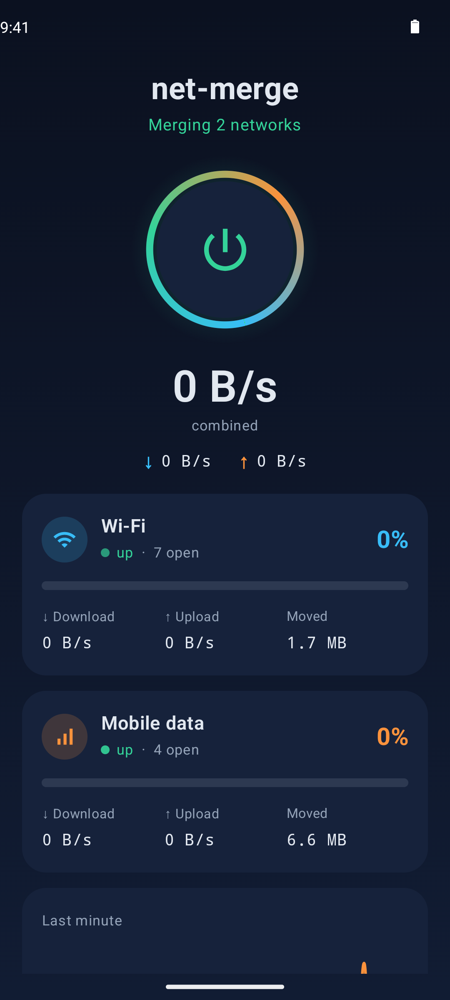
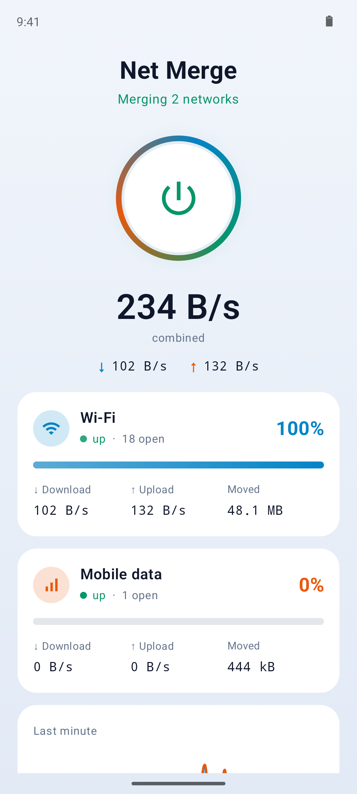
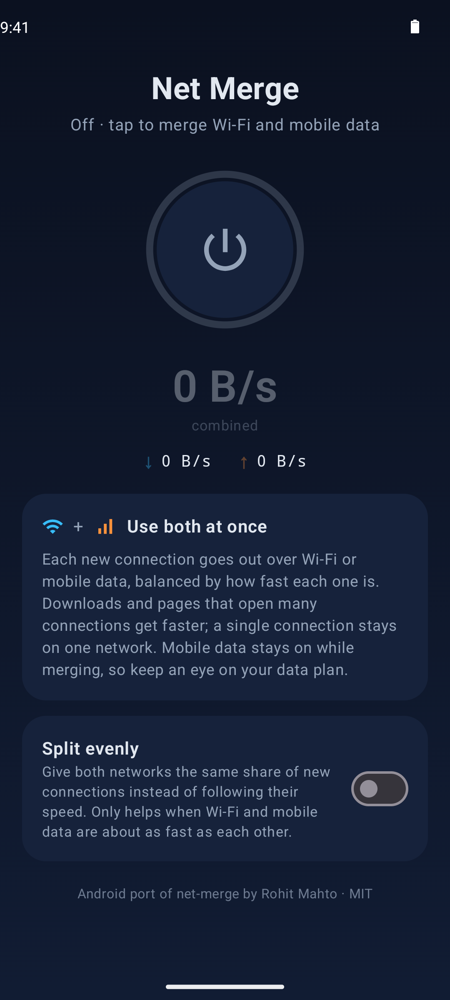

<h1 align="center">Net Merge for Android</h1>

<p align="center">
  <b>Use Wi-Fi and mobile data at the same time.</b><br>
  No root, no account, no server in between.
</p>

<p align="center">
  <a href="https://github.com/SenseiRedsmoke/net-merge-android/raw/main/download/net-merge-android.apk"><b>⬇ Download the APK</b></a>
</p>

<p align="center">
  
  &nbsp;
  
  &nbsp;
  
</p>

## What it does

Your phone normally uses only one network at a time: Wi-Fi when it is connected, mobile data
otherwise. Net Merge keeps both connected and spreads your apps' connections across them.
Faster networks get more connections, and a network that loses internet stops getting any.

## What it speeds up

Net Merge helps with anything that opens **several connections at once**:

- **Several downloads together**, like updating many apps at once in the Play Store
- **Web pages**, which load many images and files in parallel
- **Torrents**, which use dozens of connections
- **Cloud backups and sync**, like Google Photos or Google Drive uploading several files
- **Download manager apps** that split one file into parts (for example ADM or 1DM)
- **Ookla Speedtest in Multi mode**

It does **not** speed up things that use a single connection:

- One big download, such as a single game from the Play Store or one file in your browser
- A single video stream
- Online games and video calls

Those stay on one network, so they are never slower than that network on its own.

It also keeps you online: if Wi-Fi drops, new connections go over mobile data.

## Install

1. On your phone, tap **[Download the APK](https://github.com/SenseiRedsmoke/net-merge-android/raw/main/download/net-merge-android.apk)**. The file is also in the
   [download](download) folder of this repository.
2. Open the downloaded file and install it. If Android asks, allow your browser or file
   manager to install unknown apps.
3. Open **Net Merge**, tap the power button and tap **OK** on the VPN prompt.
4. Optional: add the **Net Merge** tile to your Quick Settings panel for one-tap on/off.

Requires Android 8.0 or newer.

## Using it

- **Power button:** turns merging on and off. A notification with a Stop button stays while it
  is on.
- **Network cards:** each network's status, its share of the traffic, and its live download and
  upload speeds.
- **Last minute:** a live chart of how much each network carried.
- **Split evenly:** gives both networks the same share of new connections instead of following
  their speed. Only useful when Wi-Fi and mobile data are about as fast as each other.

Mobile data stays on the whole time merging is active, so keep an eye on your data plan.

## What to expect

- **A single connection always stays on one network.** One large file download, or a speed test
  set to "Single" connection, won't get faster. Use "Multi" in Ookla Speedtest to see the
  combined speed.
- **The gain depends on how close the two networks are in speed.** Two similar networks can come
  close to doubling. If Wi-Fi is 400 Mbps and mobile data is 60 Mbps, the best possible total is
  about 460 Mbps.
- **Upload works the same way.** It only adds up when an app uploads over several connections,
  and mobile data's upload is often much slower than its download.

## How it works

Net Merge is a local VPN. Android sends all traffic to the app, and the app opens each
connection again over Wi-Fi or mobile data, then passes the data back and forth. Nothing goes
through an outside server: the VPN exists only on your phone.

For developers, in more detail:

- The VPN's interface is handled on the phone by a user-space TCP/IP stack
  ([gVisor](https://gvisor.dev) via [tun2socks](https://github.com/xjasonlyu/tun2socks)).
- Each outgoing socket is tied to one network with `android_setsocknetwork` (the NDK form of
  `Network.bindSocket`). The app leaves itself out of its own VPN, so those sockets go straight
  out.
- Android normally turns mobile data off while Wi-Fi is connected. The app keeps both up with
  `ConnectivityManager.requestNetwork`, and follows networks coming and going with
  `NetworkCallback`.
- The balancing engine (scheduler, balancer and internet checks) is the Go code from
  [net-merge](https://github.com/rohit267/net-merge) by Rohit Mahto, built for Android with
  gomobile.

## Building from source

You need Go 1.27 or newer, JDK 17, the Android SDK and an Android NDK.

```sh
export ANDROID_HOME=~/Android/Sdk
export ANDROID_NDK_HOME=$ANDROID_HOME/ndk/<version>
./scripts/build-go.sh       # builds the Go engine into app/libs/netmerge.aar
./gradlew assembleRelease   # builds app/build/outputs/apk/release/app-release.apk
```

The engine's tests run on any computer: `cd golib && go test ./...`

| Folder | Contents |
| --- | --- |
| `app/` | The Android app: VPN service, network tracking, screens and Quick Settings tile |
| `golib/netmerge` | The functions the app calls in the Go engine |
| `golib/internal/engine` | The balancing engine from upstream net-merge (commit `6093879`), plus Android additions: closing connections when their network disappears, upload-aware balancing, and starting from Android's speed estimates |
| `golib/internal/tun` | Connects the VPN interface to the engine |
| `golib/internal/nics` | Ties each socket to its Android network |
| `download/` | The latest APK, updated automatically on every release |

## Credits and license

Based on [net-merge](https://github.com/rohit267/net-merge) by Rohit Mahto. MIT licensed, like
the original. See [LICENSE](LICENSE).
